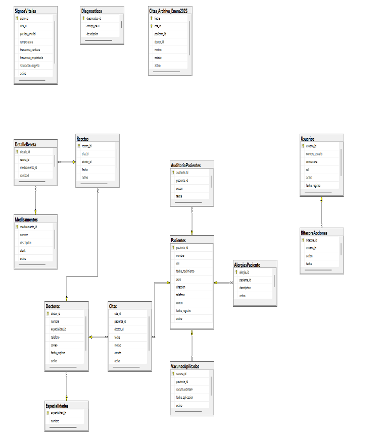

# clinic-database

A SQL Server database for a medical clinic: patients, doctors, appointments,
prescriptions, medicine stock, vital signs, vaccines, users and audit logs.

Built as the final project for the Database course at UPC (2025). It was
submitted as a 3-person team; I designed and implemented the full database.
This repository has the original project and a `v2/` with the problems I found
when I reviewed it later, and how I fixed them.



## What's inside

| | |
|---|---|
| **Model** | 16 tables with primary and foreign keys, defaults and CHECK constraints |
| **Partitioning** | Appointments partitioned by date (`PARTITION FUNCTION` + `SCHEME` on filegroups), an archive table guarded by a CHECK constraint, and a view over the data |
| **Stored procedures** | Register patients (with audit row), appointments, vital signs; create a prescription with all its medicines in one call using a **table-valued parameter** |
| **Triggers** | Subtract medicine stock on prescription, deactivate medicines at zero stock, and other status rules |
| **Security** | Roles (`rolMedico`, `rolFarmacia`, `rolAdministrador`, `rolRecepcion`) and users with `GRANT` / `REVOKE`. Doctors can only run approved procedures |
| **Integrity** | Unique DNI and email, birth date can't be in the future, valid values for sex |

```
original/
  01_schema.sql                          full database script generated from SSMS
  02_procedures_triggers_security.sql    procedures, triggers, queries, roles, constraints
v2/
  01_fixes.sql                           the fixes below
  02_checks.sql                          manual checks with expected results
docs/
  logical-model.png
```

## v2: what I fixed

Reviewing the project a year later, I found these problems:

### 1. A prescription could be left half-created, and stock could go negative
`sp_CrearRecetaConDetalles` inserted the prescription and then its details with
no transaction. If the second insert failed, an empty prescription stayed in the
database. Nothing stopped prescribing more units than were in stock.

**Fix:** one transaction with `XACT_ABORT` and `TRY/CATCH`. Stock is validated
first, adding up repeated medicines in the same request, with `UPDLOCK, HOLDLOCK`
so two prescriptions can't spend the same units at the same time. A
`CHECK (stock >= 0)` constraint is the last line of defense.

### 2. Triggers that only handled one row
Several triggers did `SELECT @id = paciente_id FROM inserted`. That keeps one
value, so an `INSERT` or `UPDATE` of many rows applied the rule to only one.

**Fix:** set-based `UPDATE ... JOIN inserted`. The stock trigger was already
written this way, which is why it worked.

### 3. Every new patient was saved as inactive
`trg_DesactivarPacienteSinCitas` ran **after insert** and deactivated patients
without an appointment in the last year. A brand-new patient never has one.

**Fix:** inactivity depends on time passing, not on a row change, so it moved to
`sp_DesactivarPacientesInactivos`, meant to run on a schedule (a nightly SQL
Agent job), with a grace period for recently registered patients.

### 4. A trigger that never changed anything
`trg_DesactivarDoctorInactivo` set `activo = 0` only on doctors whose `activo`
was already `0`. It was replaced by `sp_DesactivarDoctoresInactivos`, which
deactivates doctors with no appointments in the last 6 months.

### 5. Only one patient could have no email
The unique index on `correo` was created on a nullable column, and SQL Server
treats NULLs as equal in a unique index. **Fix:** a filtered unique index
(`WHERE correo IS NOT NULL`).

### 6. Patient and audit row were not atomic
`sp_InsertarPaciente` now writes both rows in one transaction.

### Running the checks
Run `original/` then `v2/01_fixes.sql` on a **test** database, then
`v2/02_checks.sql`. Each check prints `PASS` or `FAIL`, and the test rows are
deleted at the end.

## Known limitations (not changed in v2)

- **`Citas` has no primary key.** It is partitioned on `fecha`, and a primary key
  on a partitioned table must include the partitioning column. Without it,
  `Recetas` and `SignosVitales` can't have a foreign key to `Citas`, so those
  links are only by ID. The proper fix is a key on `(cita_id, fecha)`.
- **`Usuarios.contrasena` is a plain text column.** Passwords should be hashed
  with a salt (for example bcrypt) by the application before they reach the
  database.
- Two of the three filegroups created for appointments are not used by the
  partition scheme yet.

## Stack

SQL Server 2022 · T-SQL · SSMS
